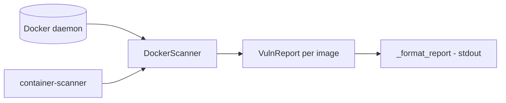

# container-scanner-imagens

**English** · [Português (Brasil)](README.md)

[](#) [](#) [](#) [](LICENSE)

## What it is

**A simple Docker image scanner**: it lists the host's local images (via the docker-py SDK), evaluates each one with **severity weights** (low/medium/high) and produces a **vulnerability report** per image with an aggregated score. It is an educational container-security lab.

## Status

An educational lab, working and tested (13 tests).

## Features

- **Image inventory** (`scanner.py`): `DockerScanner.list_images` — lists local Docker images as `ImageInfo` (id, tags).
- **Vulnerability report**: a `VulnReport` per image, with `Finding` (title, description, low/medium/high severity) and a weighted `score`.
- **Docker detection**: if the SDK is unavailable or the daemon does not respond, the scanner degrades gracefully (`_import_docker`, `_client_or_none`).
- **CLI**: `container-scanner` — scans all local images and prints the report.

## Architecture

A `container_scanner_imagens` package with `scanner.py` (inventory + report) and `__main__.py` (CLI/formatting).



## Stack

- Python ≥ 3.10
- docker (docker-py) ≥ 6.0, < 8.0
- pytest (dev)

## Repository layout

```
container-scanner-imagens/
├── pyproject.toml · BRIEF.md
├── src/container_scanner_imagens/
│   ├── scanner.py    # inventory + vulnerability report
│   └── __main__.py   # CLI
├── tests/            # 13 tests
└── LICENSE           # MIT
```

## Prerequisites and installation

- Python ≥ 3.10
- Docker running on the host (for a real scan; tests use fakes)

```bash
pip install -e .
```

## How to run

```bash
container-scanner
# lists local images and prints the vulnerability report
```

## Tests and quality

Real command (verified by the agent):

```bash
PYTHONPATH=src python -m pytest tests/
# 13 passed
```

## Technical decisions and trade-offs

- **Client injection in the scanner** (optional `client`): allows testing without a real Docker daemon.
- **Severity-weighted score**: quick image prioritisation; the findings come from lab heuristics, not a full CVE scanner (Trivy/Grype).

## Known limitations and roadmap

- No real CVE layer scan (compare with Trivy/Grype); findings come from built-in heuristics.
- Requires Docker on the host to list real images.

## Development process

An individual project by Kelvin Oliveira, built with orchestrated AI agents and reviewed by the author.

## License and author

MIT — Copyright (c) 2026 Kelvin Rebelo de Oliveira. Author: [Kelvin Oliveira](https://github.com/KelvinOliveiraCode) · [Portfolio](https://kelvinoliveiracode.github.io/portfolio/)
