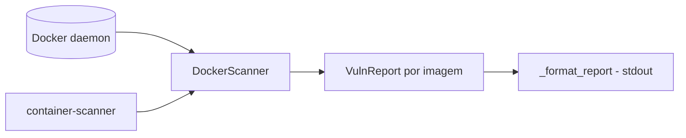

# container-scanner-imagens

[English](README.en.md) · **Português (Brasil)**

[](#) [](#) [](#) [](LICENSE)

## O que é

**Scanner simples de imagens Docker**: lista as imagens locais do host (via SDK docker-py), avalia cada uma com **pesos por severidade** (baixa/média/alta) e gera um **relatório de vulnerabilidades** por imagem com score agregado. É um laboratório educacional de segurança de contêineres.

## Status

Laboratório educacional funcional e testado (13 testes).

## Funcionalidades

- **Inventário de imagens** (`scanner.py`): `DockerScanner.list_images` — lista imagens Docker locais como `ImageInfo` (id, tags).
- **Relatório de vulnerabilidades**: `VulnReport` por imagem, com `Finding` (título, descrição, severidade baixa/média/alta) e `score` ponderado.
- **Detecção de Docker**: se o SDK não estiver disponível ou o daemon não responder, o scanner degrada graciosamente (`_import_docker`, `_client_or_none`).
- **CLI**: `container-scanner` — escaneia todas as imagens locais e imprime o relatório.

## Arquitetura

Pacote `container_scanner_imagens` com `scanner.py` (inventário + relatório) e `__main__.py` (CLI/formatação).



## Stack

- Python ≥ 3.10
- docker (docker-py) ≥ 6.0, < 8.0
- pytest (dev)

## Estrutura do repositório

```
container-scanner-imagens/
├── pyproject.toml · BRIEF.md
├── src/container_scanner_imagens/
│   ├── scanner.py    # inventário + relatório de vulnerabilidades
│   └── __main__.py   # CLI
├── tests/            # 13 testes
└── LICENSE           # MIT
```

## Pré-requisitos e instalação

- Python ≥ 3.10
- Docker rodando no host (para scan real; os testes usam fakes)

```bash
pip install -e .
```

## Como executar

```bash
container-scanner
# lista as imagens locais e imprime o relatório de vulnerabilidades
```

## Testes e qualidade

Comando real (verificado pelo agente):

```bash
PYTHONPATH=src python -m pytest tests/
# 13 passed
```

## Decisões técnicas e trade-offs

- **Injeção de client no scanner** (`client` opcional): permite testar sem Docker real.
- **Score ponderado por severidade**: priorização rápida de imagens; as origens dos achados são heurísticas do lab, não um scanner CVE completo (Trivy/Grype).

## Limitações conhecidas e roadmap

- Não faz scan CVE real de camadas (comparável a Trivy/Grype); os findings vêm das heurísticas embutidas.
- Requer Docker no host para listar imagens reais.

## Processo de desenvolvimento

Projeto individual de Kelvin Oliveira, construído com agentes de IA orquestrados e revisado pelo autor.

## Licença e autor

MIT — Copyright (c) 2026 Kelvin Rebelo de Oliveira. Autor: [Kelvin Oliveira](https://github.com/KelvinOliveiraCode) · [Portfólio](https://kelvinoliveiracode.github.io/portfolio/)
